# Netflix Movies & TV Shows — Data Visualization
**CodeAlpha Data Analytics Internship — Task 3**

---

## Project Overview
This project transforms the raw Netflix Movies & TV Shows dataset into a rich set of data visualizations that reveal insights about the platform's global content strategy. Starting from five targeted business questions, the analysis produces **12 charts** plus a **multi-panel summary dashboard**, all built with Python (pandas, Matplotlib, Seaborn).

Every finding is backed by a number computed directly in the code — no invented statistics.

---

## Dataset
| Field | Detail |
|-------|--------|
| **Name** | Netflix Movies and TV Shows |
| **Source** | [Kaggle — shivamb/netflix-shows](https://www.kaggle.com/datasets/shivamb/netflix-shows) |
| **File** | `data/netflix_titles.csv` |
| **Rows** | 8,807 titles |
| **Key columns** | `type`, `title`, `director`, `cast`, `country`, `date_added`, `release_year`, `rating`, `duration`, `listed_in` |

> **Setup:** Download `netflix_titles.csv` from the Kaggle link above and place it at `data/netflix_titles.csv` before running.

---

## Business Questions
| # | Question |
|---|----------|
| Q1 | What is the overall split between Movies and TV Shows on Netflix? |
| Q2 | How has Netflix's content library grown over the years, and is there seasonality in when content is added? |
| Q3 | Which countries and genres dominate the Netflix catalog? |
| Q4 | How long are Netflix movies, and does content maturity rating affect duration? |
| Q5 | How does content maturity differ between Movies and TV Shows, and what does the TV Show season landscape look like? |

---

## Tools Used
- **Python 3.x**
- **pandas** — data loading, cleaning, aggregation, explode for multi-value columns
- **NumPy** — numeric operations
- **Matplotlib** — base charting, dashboard layout (GridSpec)
- **Seaborn** — statistical plots (violin, heatmap)
- **SciPy** — linear regression for trendlines
- **Jupyter** — interactive notebook

---

## Repository Structure
```
CodeAlpha_DataVisualization/
├── data/
│   └── netflix_titles.csv        ← download from Kaggle (not committed)
├── notebooks/
│   └── netflix_visualization.ipynb
├── src/
│   └── generate_figures.py
├── visuals/
│   ├── 00_dashboard.png
│   ├── 01_content_type_bar.png
│   ├── 02_titles_per_year_line.png
│   ├── 03_release_vs_added_scatter.png
│   ├── 04_movie_duration_hist.png
│   ├── 05_tv_seasons_bar.png
│   ├── 06_top_countries_bar.png
│   ├── 07_top_genres_bar.png
│   ├── 08_rating_stacked_bar.png
│   ├── 09_rating_genre_heatmap.png
│   ├── 10_month_year_heatmap.png
│   ├── 11_duration_by_rating_violin.png
│   └── 12_yoy_growth_line.png
├── README.md
├── requirements.txt
├── submission_checklist.md
├── linkedin_content.md
└── .gitignore
```

---

## How to Run

### 1. Install dependencies
```bash
pip install -r requirements.txt
```

### 2. Place the dataset
Download `netflix_titles.csv` from [Kaggle](https://www.kaggle.com/datasets/shivamb/netflix-shows) and save it to `data/netflix_titles.csv`.

### 3a. Run the standalone script (regenerates all figures)
```bash
py src/generate_figures.py
```
All 13 figures saved to `visuals/` at 300 dpi.

### 3b. Run the Jupyter notebook (interactive)
```bash
cd notebooks
jupyter notebook netflix_visualization.ipynb
```
Run all cells: **Kernel → Restart & Run All**.

---

## Dashboard

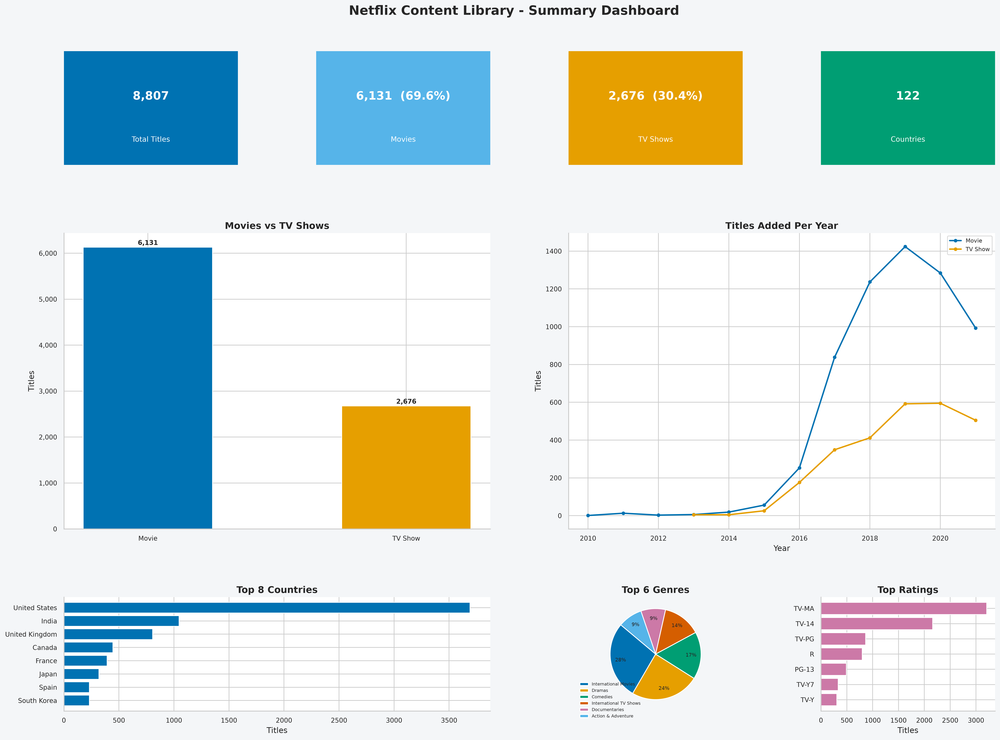

The dashboard contains:
- **4 KPI tiles**: Total Titles (8,807) · Movies (6,131 · 69.6%) · TV Shows (2,676 · 30.4%) · Countries (123)
- **Panel A**: Movies vs TV Shows bar chart
- **Panel B**: Titles added per year (line, by type)
- **Panel C**: Top 8 countries (exploded)
- **Panel D**: Top 6 genres pie (exploded)
- **Panel E**: Top content ratings bar

---

## Charts

| File | Chart Type | Business Question |
|------|-----------|-------------------|
| 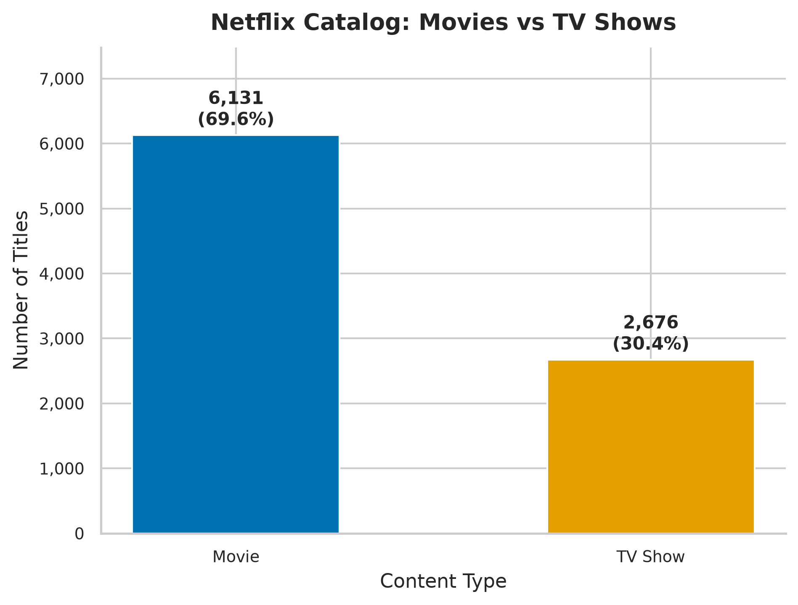 `01_content_type_bar.png` | Bar | Q1 |
| 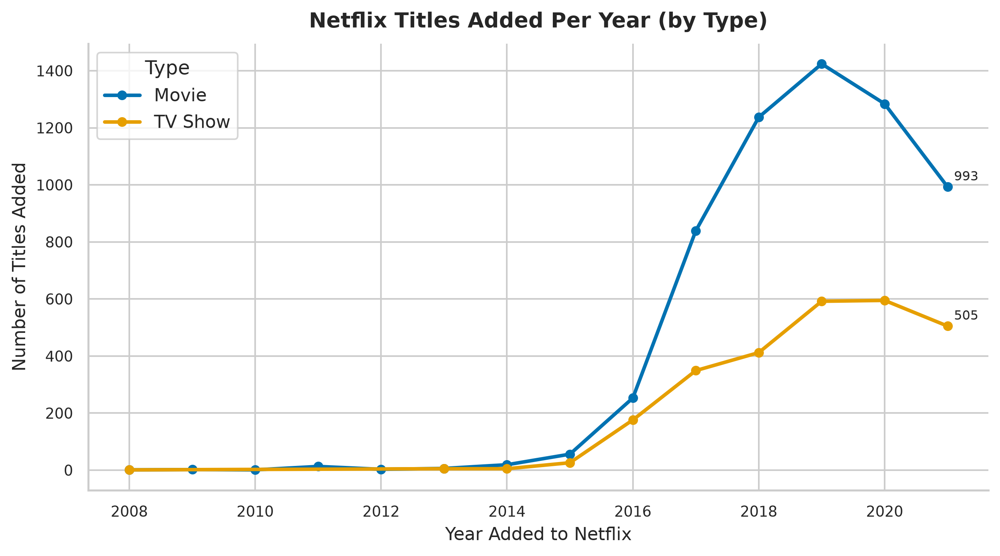 `02_titles_per_year_line.png` | Line / Trend | Q2 |
| 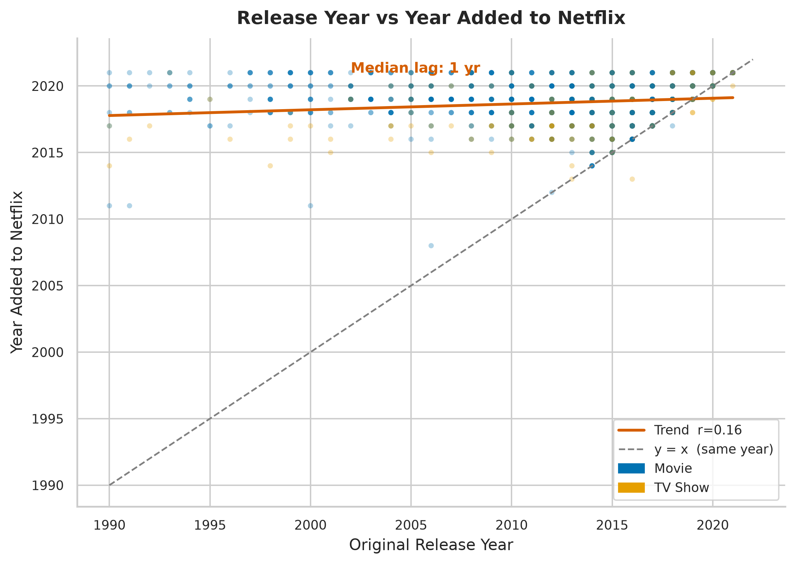 `03_release_vs_added_scatter.png` | Scatter + Trendline | Q2 |
| 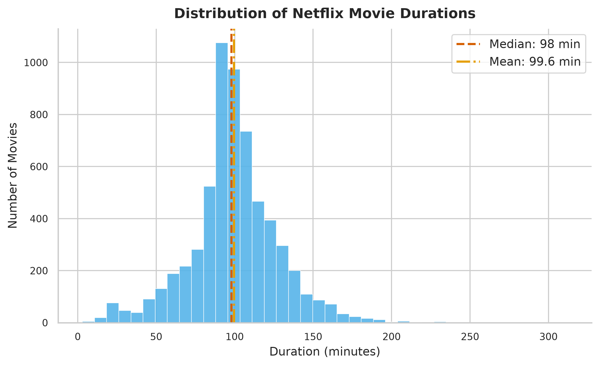 `04_movie_duration_hist.png` | Histogram | Q4 |
| 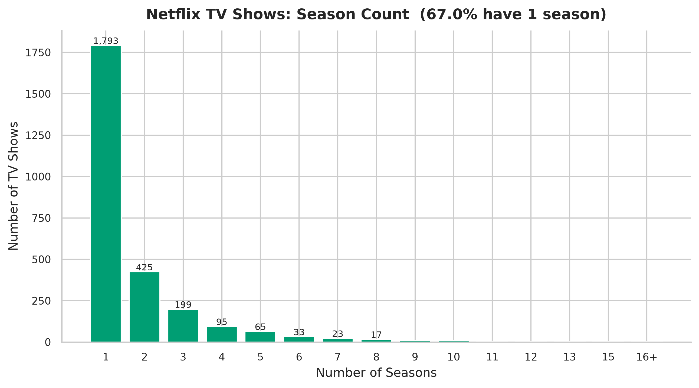 `05_tv_seasons_bar.png` | Bar | Q5 |
| 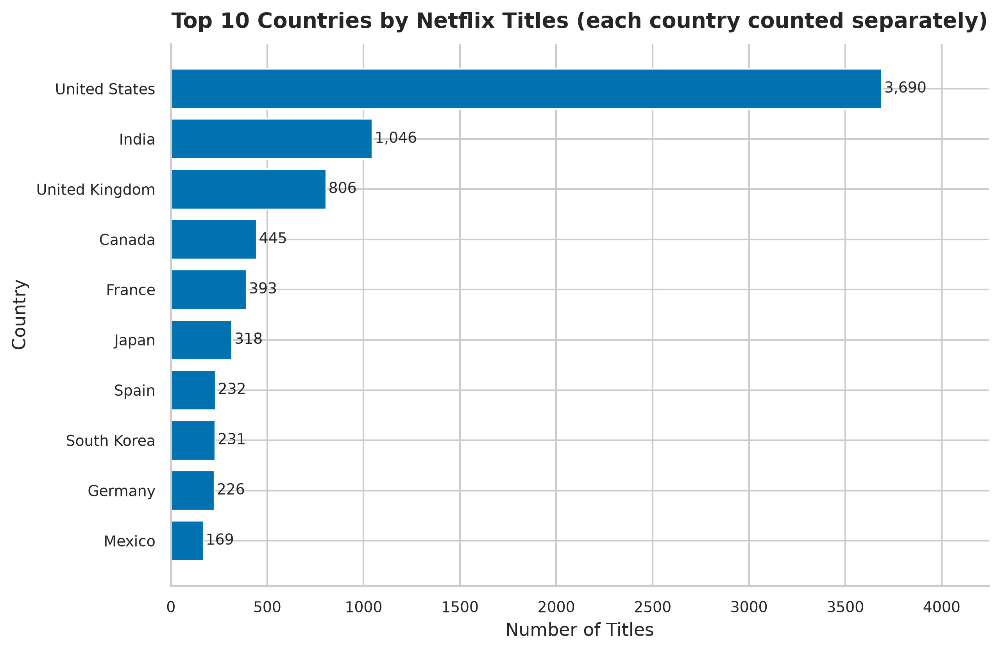 `06_top_countries_bar.png` | Horizontal Bar (exploded) | Q3 |
| 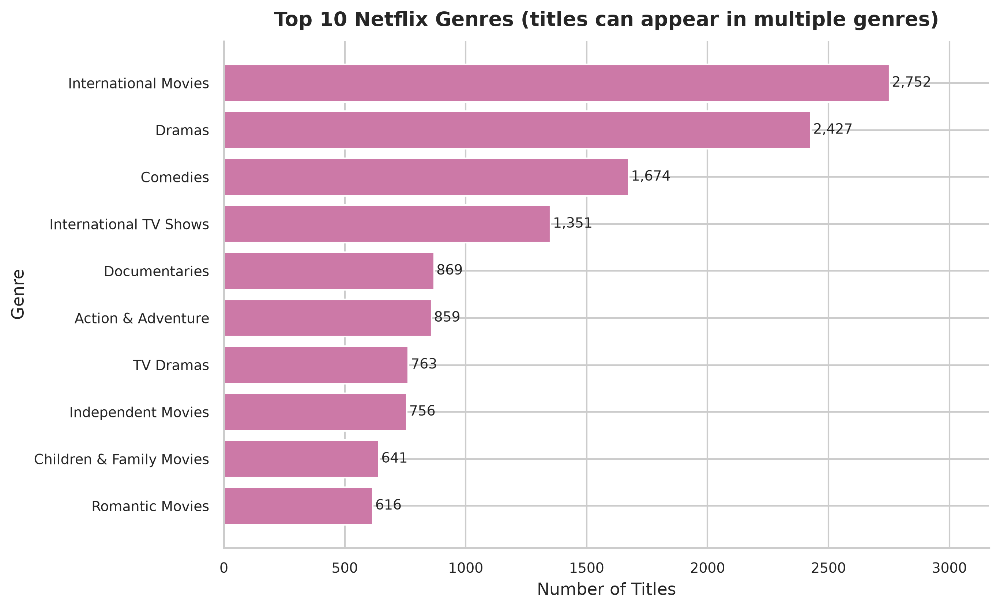 `07_top_genres_bar.png` | Horizontal Bar (exploded) | Q3 |
| 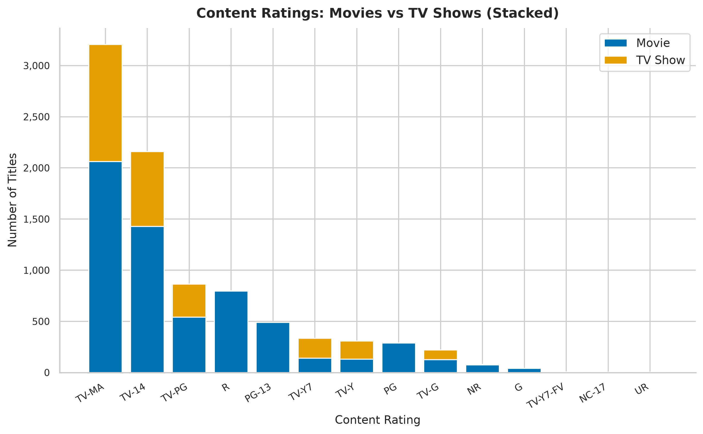 `08_rating_stacked_bar.png` | Stacked Bar | Q5 |
| 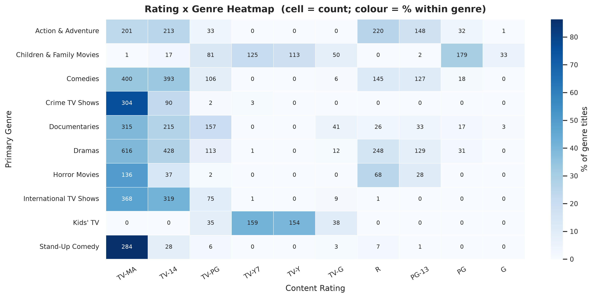 `09_rating_genre_heatmap.png` | Heatmap | Q3/Q5 |
| 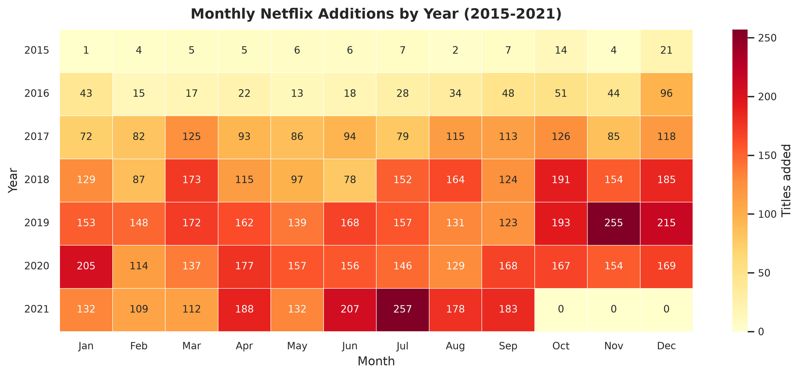 `10_month_year_heatmap.png` | Heatmap | Q2 |
| 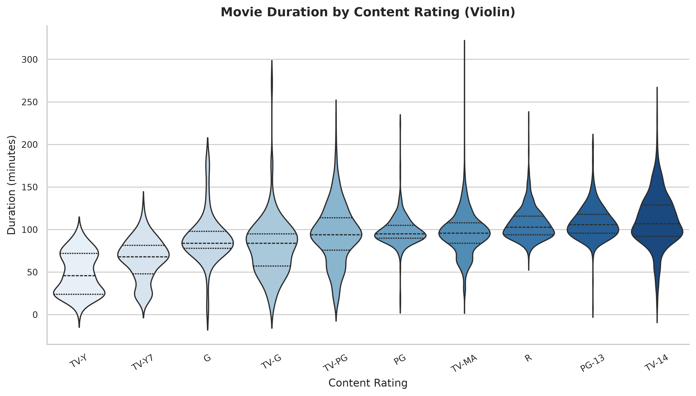 `11_duration_by_rating_violin.png` | Violin | Q4 |
| 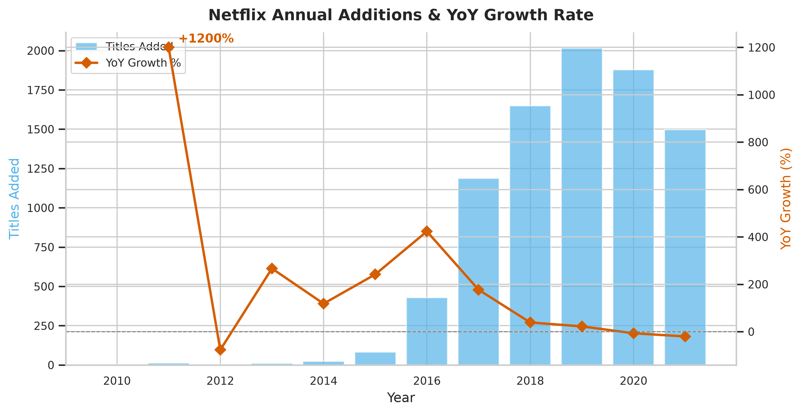 `12_yoy_growth_line.png` | Dual-axis Line + Bar | Q2 |
|  `00_dashboard.png` | Multi-panel Dashboard | All |

---

## Key Insights
_(All numbers computed from `netflix_titles.csv` — no invented statistics)_

1. **Movies dominate at 69.6%** — 6,131 movies vs 2,676 TV Shows out of 8,807 total titles.
2. **Explosive growth 2015–2019** — the library more than doubled year-over-year at its peak; additions slowed post-2019.
3. **USA leads with 3,690 titles** (exploded count); India (1,046) and UK (806) are next.
4. **International Movies (2,752) and Dramas (2,427) are the top genres** by exploded count.
5. **Movies average 99.6 min (median 98 min)** — tightly clustered around the 90-minute feature-film standard.
6. **TV-MA is the largest single rating** with 3,207 titles — Netflix is adult-audience-first.
7. **67% of TV Shows have exactly 1 season** — limited-series is the dominant format.
8. **Median release-to-Netflix lag = 1 year** — Netflix increasingly adds near-release content.
9. **July is the peak addition month** with 826 total titles added across 2015–2021.
10. **R-rated/TV-MA movies run ~100+ min median** vs ~78 min for G-rated — maturity correlates with length.

---

## Recommendations
| Question | Recommendation |
|----------|----------------|
| Q1 | Increase TV Show share toward ~40% to improve watch-time per subscriber. |
| Q2 | Lean into quality-over-quantity; time major originals for July and January seasonal spikes. |
| Q3 | Invest in Korean, Spanish, and Indian originals — proven demand. Country-specific spotlight hubs in the app. |
| Q4 | The 90–100 min sweet spot is clear; commissioning outside 75–140 min needs strong rationale. |
| Q5 | Family-tier content (TV-G, TV-Y) is underrepresented — high-LTV growth opportunity. More 2–3 season shows would improve retention. |

---

## Data Cleaning Notes
- **Misplaced data fixed:** 3 rows had duration values (`66 min`, `74 min`, `84 min`) in the `rating` column — corrected programmatically.
- **Multi-value columns exploded:** `country` and `listed_in` are comma-separated. All country/genre counts use `explode_col()` so `"United States, India"` counts once for each country.
- **Missing values:** `director` (2,634), `cast` (825), `country` (831) filled `"Unknown"`. `rating` (4) filled `"Unknown"`. `date_added` (10) kept as NaT.
- **0 true duplicates** found on `show_id`.

---

## Author
**Suvam Suryakanta Nayak**
Data Analytics Intern — CodeAlpha

---

## LinkedIn Video
> _Link to be added after posting_

**[Project Walkthrough Video — PLACEHOLDER](#)** ← _replace with your LinkedIn video URL after posting_

---

## Acknowledgements
Dataset by [Shivam Bansal](https://www.kaggle.com/shivamb) on Kaggle, licensed under CC0: Public Domain.
